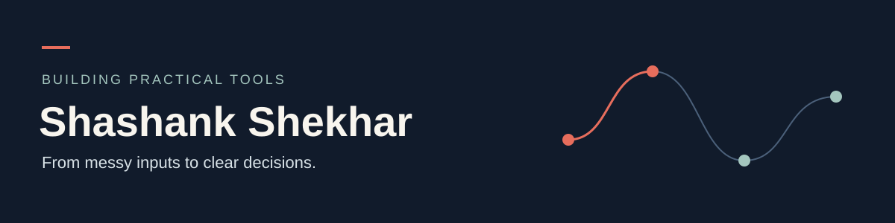

# Shashank Shekhar

### I build useful software for real-world workflows.

From a stack of event business cards to a map full of billboard options, I like turning scattered information into tools that help people make the next decision.

[Explore my projects](#selected-work) · [See what I'm building](#currently-building)

---

## Selected work

### [AAJ Contact Scan](https://github.com/shashankshekharans/aaj-scan)

**From event business cards to a checked HubSpot contact list.** Capture cards on a phone, use AI to extract the details, review anything uncertain, and export a CRM-ready CSV.

[Try the app](https://aaj.contact-scan.workers.dev/) · [Explore the code](https://github.com/shashankshekharans/aaj-scan)

### [Billboard Planner](https://github.com/shashankshekharans/billboard-planner)

**See every billboard before you book it.** Turn a vendor spreadsheet and site photos into a shareable satellite map with locations, distances, rates, and a costing table.

[Open the planner](https://shashankshekharans.github.io/billboard-planner/) · [Explore the code](https://github.com/shashankshekharans/billboard-planner)

## Currently building

Some projects are still private while I work on them:

- A dashboard that turns public logistics competitor posts into evidence-backed marketing insights.
- Digital experiences for AAJ Supply Chain Management, including its main website and location pages.
- A searchable library of brand guidelines and visual identity references.

## Tools I work with

**TypeScript · Python · Next.js · Cloudflare · AI-assisted workflows**

I care about the part after a demo: whether a tool is clear, trustworthy, and usable by the team it was built for.

---

**Have a workflow that deserves a better tool?** [Start a conversation on GitHub](https://github.com/shashankshekharans)

